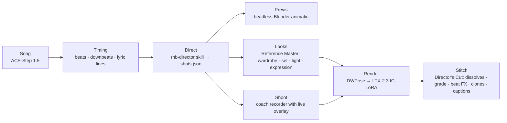

# popstar

**Make anyone a pop star in a '90s R&B music video.** Record ~30 seconds of yourself lip-syncing to an original
song; one pipeline turns it into a music video of *you*: your real motion, new wardrobe, sets and light per scene,
a girl group of you on the harmonies, cut on the downbeats. Open-weights models only, rendered on Comfy Cloud,
directed by a Claude Code harness.

Built for the Open Source Higgsfield hackathon (2026-11-02 → 03). Status: the studio is built and every model step is
verified on real footage; the first full video is being shot and stitched. `HANDOFF.md` is the live state.

## How it works



| Stage | Tool | What it does |
|---|---|---|
| Song | Comfy Cloud, ACE-Step 1.5 XL Turbo | Original song from lyrics + style tags; you lock a take |
| Timing | `tools/song_timing.py` | Beats, downbeats, lyric line times (beat_this + Whisper) |
| Direct | skill `rnb-director` | Scenes, camera, light, emotion, hand choreography, cut points on downbeats |
| Previs | `previs/build_previs.py` | A 3D animatic with the song, cameras bound to the cuts |
| Looks | `reference-master/` | Per-scene wardrobe/set/light edits of your own frame, plus editable eyes/mouth/head sliders; Pinterest refs tray |
| Shoot | `recorder/` | Karaoke lyrics, beat HUD, move cards on the beat, pose warnings; records the raw camera only |
| Render | pinned graphs in `workflows/` + `tools/comfy_compile.ts` | Your skeleton drives LTX-2.3; a look render anchors identity per scene |
| Stitch | `cut/` + `tools/stitch.ts` | Live edit against the song, then a deterministic ffmpeg render |

## Quickstart
Requirements: [Bun](https://bun.sh), [uv](https://docs.astral.sh/uv/), ffmpeg ≥ 7, Python 3.12 (via uv), Blender 5.x (previs only),
a Comfy Cloud account connected to Claude Code through the `comfy-cloud` MCP (`/mcp`).

```bash
bun tools/popstar.ts doctor     # checks every dependency and prints the fix for each miss
bun tools/popstar.ts status     # the eight stages and the one next step
bun tools/popstar.ts studio     # starts the recorder, Reference Master and Director's Cut on one hub page
```
Then follow `templates/music-video/README.md` for a new song and performer.

## Repo map
`PLAN.md` vision and locked decisions · `HANDOFF.md` state, job ids, gotchas · `docs/` research (R&B video language,
orchestration, Hermes/NousCon), architecture review, licenses, capture list, taste profile · `.claude/skills/` the
director, looks and pipeline skills · `workflows/` pinned Comfy graphs + slot map · `tools/` CLI, compiler, timing,
QA, stitch · `recorder/` `reference-master/` `cut/` `previs/` `storyboards/` the studio tools · `templates/` the
reusable recipe and shot-list schema · `songs/` the locked song and its recipe.

Personal media (takes, renders of the performer, reference pins) is gitignored by default.

## Open weights, licenses, credits
Every model is open-weights and runs on Comfy Cloud with no partner API nodes. Most are MIT/Apache; LTX-2.3 uses the
LTX-2 Community License and Gemma the Gemma Terms (see `NOTICE`). One component, Qwen-Image 2.1 Turbo, is
research-only; an Apache-2.0 Qwen-Image-Edit graph is the commercial-safe alternative. Full audit: `docs/LICENSES.md`.

Light-leak footage by Jeffrey Beach (Beachfront Productions) via the Internet Archive, CC BY 3.0, modified.
"Film Leader" by The Chosen One via the Internet Archive, public domain.

## License
Apache-2.0 for this repository's code and documents (see `LICENSE` and `NOTICE`). The song "In the Loop (Devagar)"
and the performer's likeness belong to the author and are not licensed for reuse.
