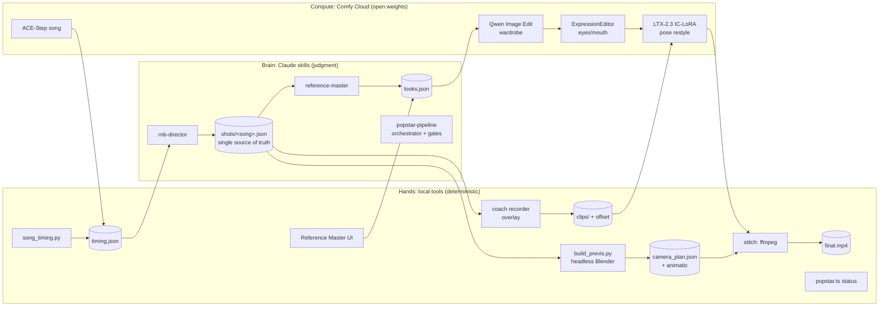

# Architecture review: the pop-star pipeline

Reviewed 2026-11-02 ~22:00 ET. Covers what we built, whether it should be a "workflow", what breaks when someone
else tries to use it, and how to make it shareable.

## 1. What it is, as layers

The split is right: **skills decide, scripts execute, the cloud computes**. Judgment (directing, looks, QA) is the
only place an LLM sits. Everything else is a plain program you can re-run.

## 2. Is it a "workflow"? Three different answers
| Meaning | Verdict |
|---|---|
| **ComfyUI workflow** (a node graph) | Yes, each generation step is one. They must live **in the repo** as API-format JSON, not as job IDs on one account (see risk R1). |
| **Claude Code Workflow** (multi-agent script) | Yes for two stages only: **render + verify** (fan out the 4 scenes; per scene, independent checks for identity, skin tone, motion-follows-pose) and **dev builds** like the coach overlay. Save it as `.claude/workflows/popstar-render.js` so it travels with the repo. Keep it opt-in, because it burns tokens. |
| **The product pipeline itself** | **No, not an LLM loop.** It's a DAG of stages with typed artifacts (like Make, DVC or Dagster assets). Deterministic stages re-run cheaply; generative stages are cached by input hash. `popstar.ts` grows from `status` into `run <stage>`. |

## 3. What's good (keep it)
- **Contract-first data**: `shots.schema.json`, timing.json and looks.json are written down, and validators exist. Agents built against them in parallel without colliding.
- **Single source of truth** for scenes and cues (`shots/<song>.json`).
- **Human gates with receipts** (lock the song, watch the animatic, approve looks, `/check` after takes).
- **Open-weights only**, enforced in docs and skills.
- **Tools that fail soft** (the recorder works without timing/shots; pose checks degrade to a light check).

## 4. Risks, ranked (fix before sharing)
| # | Risk | Fix |
|---|---|---|
| R1 | **Renders depend on a job ID on Naledi's account** (`from_prompt_id 650120d9…`) and on flattened subgraph IDs (`129:211`) that change when Comfy updates a template. Nobody else can run it. | Export each graph to `workflows/*.api.json` (pinned snapshot); a `compile` step fills inputs and `submit_workflow`s the whole graph. Also `share_workflow` them on Comfy Cloud. |
| R2 | **Scene times are duplicated** in shots.json, looks.json and camera_plan.json, so they drift. | looks.json and camera_plan.json reference `scene.id` only; times are read from shots.json. |
| R3 | **Hardcoded song paths** (recorder server, looks seed). | One project manifest `popstar.json` {song, performer identity lock, palette, takes}. Every tool takes `--project`. |
| R4 | **No caching or invalidation** yet: a re-run re-renders everything, and credits go with it. | `build/state.json`: per artifact, the hash of its inputs and the seed; `popstar run` skips fresh ones and prints "stale because…". |
| R5 | **Privacy**: her face and body go to the cloud and the repo. | clips/, renders and refs are gitignored by default. The template ships no personal footage. Add a consent line in the README. |
| R6 | **Licenses not audited.** LTX-2.3 has its own community license; LivePortrait-based nodes rely on face-detector weights that are often research/non-commercial; ACE-Step, Qwen, DWPose and MediaPipe each have their own. | Add a `LICENSES.md` table with each model's license before calling it shareable or commercial. Until checked, say "research/demo use". |
| R7 | **Environment drift** (node 26, ffmpeg 9, uv, Blender 5.2, bun) on a new machine. | `popstar.ts doctor`: checks versions and the MCP connection and prints exact fixes. |
| R8 | **Two unverified model claims** sit in the critical path: hybrid lip-sync, and clones via a tiled pose. | Both are marked as spikes with deterministic fallbacks (pose-only; triptych). Keep it that way. |

## 5. Making it shareable: four tiers
1. **Repo template** (tonight, cheap): README + `popstar.ts doctor/status`, a LICENSE, a gitignore for personal media, and the committed workflow JSONs. Anyone with Claude Code + Comfy Cloud can run it.
2. **Claude Code plugin `popstar`** (best leverage): bundles the 3 skills, a `/popstar` command (status / next / run), the render+verify workflow, and the tools. It declares the `comfy-cloud` MCP as a requirement. Install with one command; zero copy-paste.
3. **Comfy-native share** (for judges and non-coders): `share_workflow` the pose-restyle and look graphs, and `create_app` a "Restyle my clip" App mode page. Upload a clip, pick a look, get a video, no Claude needed.
4. **Hosted web app** (shiny box, after the hackathon): the browser recorder records, the queue renders, and a link comes back.

## 6. Best practices applied (and the names to cite)
DAG of typed artifacts (Make/DVC/Dagster) · contract-first schemas (JSON Schema) · idempotent stages with
content-hash caching · human-in-the-loop checkpoints · separation of orchestration from execution · 12-factor config
for the local servers (env, ports, no hardcoded paths) · pinned, portable model graphs · fail-soft UIs ·
privacy by default for biometric media.
